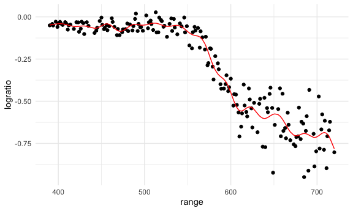

cross validation
================
Alexa Burko
2026-11-17

## LIDAR data

``` r
data("lidar")

lidar_df =
  lidar |>
  mutate(id = row_number()) |> 
  select(id, everything())

lidar_df |> 
  ggplot(aes(x = range, y = logratio)) +
  geom_point()
```


``` r
# we see from this that simple linear regression wouldn't work well 
```

Build my training and testing data sets

``` r
train_df = sample_frac(lidar_df, size = 0.8)
# sample_frac takes a random sample of the data set, size is how much of the data set you are taking a random sample of 

test_df = anti_join(lidar_df, train_df, by = "id")
# anti_join creates a data set with the observations that are not present in both data sets
```

``` r
ggplot(train_df, aes(x = range, y = logratio))+
  geom_point()+
  geom_point(data = test_df, color = "red")
```


``` r
# black points build the models, red points ask if we did a good job building the model
```

fit some models

``` r
linear_mod = lm(logratio ~ range, data = train_df)

smooth_mod = gam(logratio ~ s(range), data = train_df)
# fits logratio against a smooth function of range (try to draw a smooth line through the data)

wiggly_mod = gam(logratio ~ s(range, k = 30), sp = 10e-6, data = train_df)
```

make a plot

``` r
train_df |> 
  add_predictions(linear_mod) |> 
# adds a column of prediction to the data set (fitted values based on the linear model)
ggplot(aes(x = range, y = logratio))+
  geom_point()+
  geom_line(aes(y = pred), color = "red")
```


``` r
# this shows that the model we fitted (shown by the red line) is not a good model for the data 
```

``` r
train_df |> 
  add_predictions(smooth_mod) |> 
# adds a column of prediction to the data set (fitted values based on the linear model)
ggplot(aes(x = range, y = logratio))+
  geom_point()+
  geom_line(aes(y = pred), color = "red")
```


``` r
# this model fit is better than the last one
```

``` r
train_df |> 
  add_predictions(wiggly_mod) |> 
# adds a column of prediction to the data set (fitted values based on the linear model)
ggplot(aes(x = range, y = logratio))+
  geom_point()+
  geom_line(aes(y = pred), color = "red")
```



``` r
# this one is high variability
```

Do a model comparison!

``` r
rmse(linear_mod, test_df)
```

    ## [1] 0.1334787

``` r
rmse(smooth_mod, test_df)
```

    ## [1] 0.07450169

``` r
rmse(wiggly_mod, test_df)
```

    ## [1] 0.07982045

``` r
# root mean squared error
# returns prediction error (higher number = more prediction error = worse model fit)
```

## Repeat a bunch of times

use some nice tools

``` r
cv_df =
  crossv_mc(lidar_df, 100)
# creating 1000 random training - testing splits

cv_df |> 
  pull(train) |> 
  nth(3) |> 
  as_tibble()
```

    ## # A tibble: 176 × 3
    ##       id range logratio
    ##    <int> <dbl>    <dbl>
    ##  1     1   390  -0.0504
    ##  2     2   391  -0.0601
    ##  3     3   393  -0.0419
    ##  4     4   394  -0.0510
    ##  5     5   396  -0.0599
    ##  6     6   397  -0.0284
    ##  7     8   400  -0.0399
    ##  8     9   402  -0.0294
    ##  9    10   403  -0.0395
    ## 10    11   405  -0.0476
    ## # ℹ 166 more rows

``` r
cv_df =
  crossv_mc(lidar_df, 100) |> 
  mutate(
    train = map(train, as_tibble),
    test = map(test, as_tibble)
  )
```

let’s fit models and get rmses for these

``` r
rmse_comp = function(model, dataset) {
  
  
  rmse(model, dataset)
}
```

``` r
cv_df =
  cv_df |> 
  mutate(
    linear_fit = map(train, \(df) lm(logratio ~ range, data = df)),
    smooth_fit = map(train, \(df) gam(logratio ~ s(range), data = df)),
    wiggly_fit = map(train, \(df) gam(logratio ~ s(range, k = 30), sp = 10e-6, data = df))
  ) |> 
  mutate(
    rmse_linear = map2_dbl(linear_fit, test, rmse),
    rmse_smooth = map2_dbl(smooth_fit, test, rmse),
    rmse_wiggly = map2_dbl(wiggly_fit, test, rmse)
  )
# mapping across two columns with the function rmse_comp
```

``` r
cv_df |> 
  select(starts_with("rmse_")) |> 
  pivot_longer(
    everything(),
    names_to = "model",
    names_prefix = "rmse_",
    values_to = "rmse"
  ) |> 
  ggplot(aes(x = model, y = rmse))+
  geom_violin()
```


