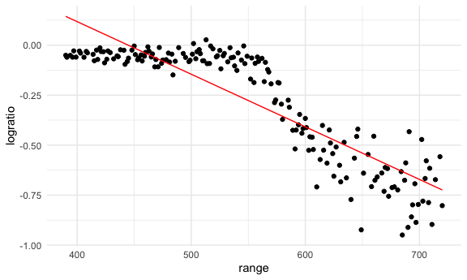
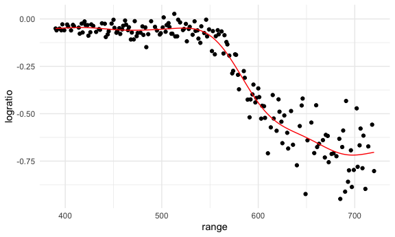

cross validation
================
Alexa Burko
2026-11-17

## LIDAR data

``` r
data("lidar")

lidar_df =
  lidar |>
  mutate(id = row_number()) |> 
  select(id, everything())

lidar_df |> 
  ggplot(aes(x = range, y = logratio)) +
  geom_point()
```


``` r
# we see from this that simple linear regression wouldn't work well 
```

Build my training and testing data sets

``` r
train_df = sample_frac(lidar_df, size = 0.8)
# sample_frac takes a random sample of the data set, size is how much of the data set you are taking a random sample of 

test_df = anti_join(lidar_df, train_df, by = "id")
# anti_join creates a data set with the observations that are not present in both data sets
```

``` r
ggplot(train_df, aes(x = range, y = logratio))+
  geom_point()+
  geom_point(data = test_df, color = "red")
```


``` r
# black points build the models, red points ask if we did a good job building the model
```

fit some models

``` r
linear_mod = lm(logratio ~ range, data = train_df)

smooth_mod = gam(logratio ~ s(range), data = train_df)
# fits logratio against a smooth function of range (try to draw a smooth line through the data)

wiggly_mod = gam(logratio ~ s(range, k = 30), sp = 10e-6, data = train_df)
```

make a plot

``` r
train_df |> 
  add_predictions(linear_mod) |> 
# adds a column of prediction to the data set (fitted values based on the linear model)
ggplot(aes(x = range, y = logratio))+
  geom_point()+
  geom_line(aes(y = pred), color = "red")
```



``` r
# this shows that the model we fitted (shown by the red line) is not a good model for the data 
```

``` r
train_df |> 
  add_predictions(smooth_mod) |> 
# adds a column of prediction to the data set (fitted values based on the linear model)
ggplot(aes(x = range, y = logratio))+
  geom_point()+
  geom_line(aes(y = pred), color = "red")
```



``` r
# this model fit is better than the last one
```

``` r
train_df |> 
  add_predictions(wiggly_mod) |> 
# adds a column of prediction to the data set (fitted values based on the linear model)
ggplot(aes(x = range, y = logratio))+
  geom_point()+
  geom_line(aes(y = pred), color = "red")
```


``` r
# this one is high variability
```

Do a model comparison!

``` r
rmse(linear_mod, test_df)
```

    ## [1] 0.1346918

``` r
rmse(smooth_mod, test_df)
```

    ## [1] 0.08856726

``` r
rmse(wiggly_mod, test_df)
```

    ## [1] 0.08827818

``` r
# root mean square estimate
# returns prediction error (higher numebr is more prediction error)
```
