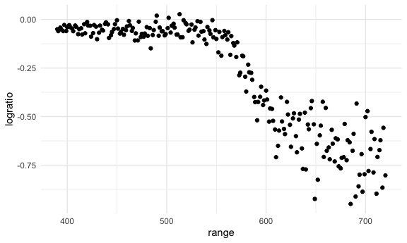
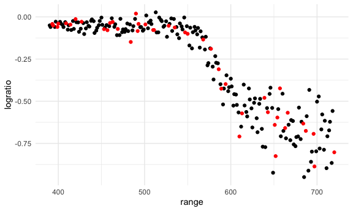
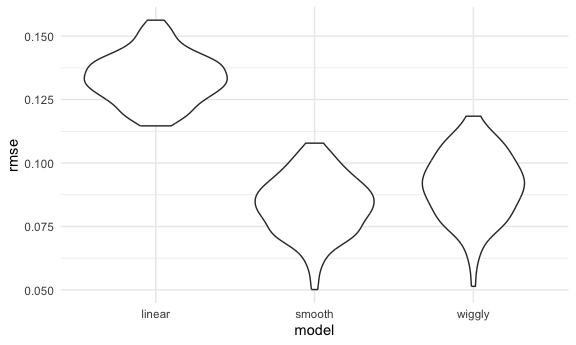
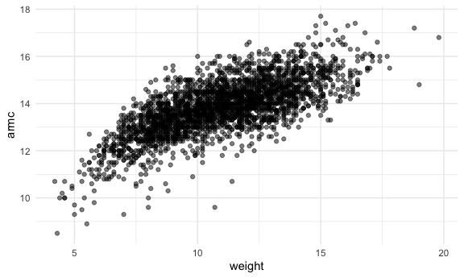
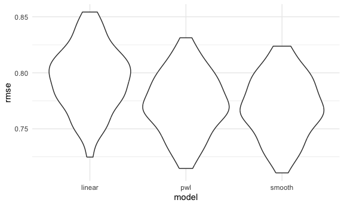

cross validation
================
Alexa Burko
2026-11-17

## LIDAR data

``` r
data("lidar")

lidar_df =
  lidar |>
  mutate(id = row_number()) |> 
  select(id, everything())

lidar_df |> 
  ggplot(aes(x = range, y = logratio)) +
  geom_point()
```



``` r
# we see from this that simple linear regression wouldn't work well 
```

Build my training and testing data sets

``` r
train_df = sample_frac(lidar_df, size = 0.8)
# sample_frac takes a random sample of the data set, size is how much of the data set you are taking a random sample of 

test_df = anti_join(lidar_df, train_df, by = "id")
# anti_join creates a data set with the observations that are not present in both data sets
```

``` r
ggplot(train_df, aes(x = range, y = logratio))+
  geom_point()+
  geom_point(data = test_df, color = "red")
```



``` r
# black points build the models, red points ask if we did a good job building the model
```

fit some models

``` r
linear_mod = lm(logratio ~ range, data = train_df)

smooth_mod = gam(logratio ~ s(range), data = train_df)
# fits logratio against a smooth function of range (try to draw a smooth line through the data)

wiggly_mod = gam(logratio ~ s(range, k = 30), sp = 10e-6, data = train_df)
```

make a plot

``` r
train_df |> 
  add_predictions(linear_mod) |> 
# adds a column of prediction to the data set (fitted values based on the linear model)
ggplot(aes(x = range, y = logratio))+
  geom_point()+
  geom_line(aes(y = pred), color = "red")
```


``` r
# this shows that the model we fitted (shown by the red line) is not a good model for the data 
```

``` r
train_df |> 
  add_predictions(smooth_mod) |> 
# adds a column of prediction to the data set (fitted values based on the linear model)
ggplot(aes(x = range, y = logratio))+
  geom_point()+
  geom_line(aes(y = pred), color = "red")
```


``` r
# this model fit is better than the last one
```

``` r
train_df |> 
  add_predictions(wiggly_mod) |> 
# adds a column of prediction to the data set (fitted values based on the linear model)
ggplot(aes(x = range, y = logratio))+
  geom_point()+
  geom_line(aes(y = pred), color = "red")
```


``` r
# this one is high variability
```

Do a model comparison!

``` r
rmse(linear_mod, test_df)
```

    ## [1] 0.1253967

``` r
rmse(smooth_mod, test_df)
```

    ## [1] 0.0756746

``` r
rmse(wiggly_mod, test_df)
```

    ## [1] 0.07919642

``` r
# root mean squared error
# returns prediction error (higher number = more prediction error = worse model fit)
```

## Repeat a bunch of times

use some nice tools

``` r
cv_df =
  crossv_mc(lidar_df, 100)
# creating 1000 random training - testing splits

cv_df |> 
  pull(train) |> 
  nth(3) |> 
  as_tibble()
```

    ## # A tibble: 176 × 3
    ##       id range logratio
    ##    <int> <dbl>    <dbl>
    ##  1     1   390  -0.0504
    ##  2     3   393  -0.0419
    ##  3     4   394  -0.0510
    ##  4     5   396  -0.0599
    ##  5     6   397  -0.0284
    ##  6     7   399  -0.0596
    ##  7     8   400  -0.0399
    ##  8     9   402  -0.0294
    ##  9    11   405  -0.0476
    ## 10    12   406  -0.0604
    ## # ℹ 166 more rows

``` r
cv_df =
  crossv_mc(lidar_df, 100) |> 
  mutate(
    train = map(train, as_tibble),
    test = map(test, as_tibble)
  )
```

let’s fit models and get rmses for these

``` r
rmse_comp = function(model, dataset) {
  
  
  rmse(model, dataset)
}
```

``` r
cv_df =
  cv_df |> 
  mutate(
    linear_fit = map(train, \(df) lm(logratio ~ range, data = df)),
    smooth_fit = map(train, \(df) gam(logratio ~ s(range), data = df)),
    wiggly_fit = map(train, \(df) gam(logratio ~ s(range, k = 30), sp = 10e-6, data = df))
  ) |> 
  mutate(
    rmse_linear = map2_dbl(linear_fit, test, rmse),
    rmse_smooth = map2_dbl(smooth_fit, test, rmse),
    rmse_wiggly = map2_dbl(wiggly_fit, test, rmse)
  )
# mapping across two columns with the function rmse_comp
```

``` r
cv_df |> 
  select(starts_with("rmse_")) |> 
  pivot_longer(
    everything(),
    names_to = "model",
    names_prefix = "rmse_",
    values_to = "rmse"
  ) |> 
  ggplot(aes(x = model, y = rmse))+
  geom_violin()
```



## Child growth

``` r
growth_df = 
  read_csv("data/nepalese_children.csv") |> 
  mutate(
    weight_ch7 = (weight > 7)*(weight - 7)
  )
```

    ## Rows: 2705 Columns: 5
    ## ── Column specification ────────────────────────────────────────────────────────
    ## Delimiter: ","
    ## dbl (5): age, sex, weight, height, armc
    ## 
    ## ℹ Use `spec()` to retrieve the full column specification for this data.
    ## ℹ Specify the column types or set `show_col_types = FALSE` to quiet this message.

Look at this

``` r
growth_df
```

    ## # A tibble: 2,705 × 6
    ##      age   sex weight height  armc weight_ch7
    ##    <dbl> <dbl>  <dbl>  <dbl> <dbl>      <dbl>
    ##  1    41     1   12.8   91.2  14.3        5.8
    ##  2    57     2   14.9  104.   13.9        7.9
    ##  3    35     2   12.1   86.4  14.4        5.1
    ##  4    46     1   13.9   96.4  13.5        6.9
    ##  5    26     2    8.7   78.5  12.1        1.7
    ##  6    57     1   12.1   89.9  13.9        5.1
    ##  7    22     1    9.8   79.1  13          2.8
    ##  8    55     1   13.7   92.6  13.6        6.7
    ##  9    20     1   10.1   77.7  14.5        3.1
    ## 10    36     2   11.2   79.8  14.4        4.2
    ## # ℹ 2,695 more rows

``` r
growth_df |> 
  ggplot(aes(x = weight, y = armc)) +
  geom_point(alpha = .5)
```



``` r
# while it looks kind of linear in the middle, there are many outliers on the ends
```

``` r
linear_fit = lm(armc ~ weight, data = growth_df)

smooth_fit = gam(armc ~ s(weight), data = growth_df)

pwl_fit = lm(armc ~ weight + weight_ch7, data = growth_df)
```

``` r
growth_df |> 
  add_predictions(pwl_fit) |> 
ggplot(aes(x = weight, y = armc))+
  geom_point(alpha = .5)+
  geom_line(aes(y = pred), color = "red")
```


do all the CV studd we know and love

``` r
cv_df =
  crossv_mc(growth_df, 100) |> 
  mutate(train = map(train, as.tibble),
         test = map(test, as.tibble)
           )
```

    ## Warning: There was 1 warning in `mutate()`.
    ## ℹ In argument: `train = map(train, as.tibble)`.
    ## Caused by warning:
    ## ! `as.tibble()` was deprecated in tibble 2.0.0.
    ## ℹ Please use `as_tibble()` instead.
    ## ℹ The signature and semantics have changed, see `?as_tibble`.
    ## ℹ The deprecated feature was likely used in the purrr package.
    ##   Please report the issue at <https://github.com/tidyverse/purrr/issues>.

``` r
cv_df =
  cv_df |> 
  mutate(
    linear_fit = map(train, \(df) lm(armc ~ weight, data = df)),
    smooth_fit = map(train, \(df) gam(armc ~ s(weight), data = df)),
    pwl_fit = map(train, \(df) gam(armc ~ weight + weight_ch7, data = df))
  ) |> 
  mutate(
    rmse_linear = map2_dbl(linear_fit, test, rmse),
    rmse_smooth = map2_dbl(smooth_fit, test, rmse),
    rmse_pwl = map2_dbl(pwl_fit, test, rmse)
  )
# mapping across two columns with the function rmse_comp
```

``` r
cv_df |> 
  select(starts_with("rmse_")) |> 
  pivot_longer(
    everything(),
    names_to = "model",
    names_prefix = "rmse_",
    values_to = "rmse"
  ) |> 
  ggplot(aes(x = model, y = rmse))+
  geom_violin()
```


